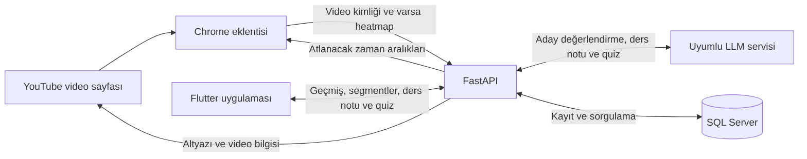

# Öğrenci Video Asistanı

YouTube eğitim videolarındaki reklam, sponsor, abonelik çağrısı ve intro/outro gibi bölümleri tespit ederek otomatik atlamayı sağlayan bir bitirme projesi. Chrome eklentisi üzerinden yapılan analizler, aynı hesapla giriş yapılan Flutter uygulamasında görüntülenebilir. Video altyazılarından LLM destekli ders notları ve mini quizler üretilebilir.

Proje; Chrome eklentisi, Python API ve Android için yapılandırılmış Flutter uygulamasından oluşur. Mevcut sürüm yerel geliştirme ve akademik gösterim odaklıdır.

## Özellikler

### Chrome eklentisi

- Kullanıcı kaydı, giriş ve çıkış.
- Açık YouTube videosu için analiz başlatma ve analiz durumunu izleme.
- Atlanacak zaman aralıklarını, bölüm bilgisini ve atlama nedenini görüntüleme.
- Otomatik atlatmayı başlatma ve durdurma.
- Son analizi yerel depolamada saklama ve aynı video için geri yükleme.
- Sayfadan heatmap verisi çıkarmayı deneme; veri bulunamadığında analize heatmap olmadan devam etme.

### Backend

- Türkçe veya İngilizce YouTube altyazılarını alma.
- Altyazı, video başlığı, açıklama, chapter ve mevcutsa heatmap bilgilerini analizde kullanma.
- Kural tabanlı aday seçimi ve LLM değerlendirmesiyle atlanacak bölümleri belirleme.
- Eğitim içeriğini korumaya yönelik filtreleme ve yakın zaman aralıklarını birleştirme.
- Video, altyazı, segment, kullanıcı analiz geçmişi, ders notu ve quiz verilerini SQL Server'da saklama.
- Uzun altyazıları parçalara ayırarak ders notu üretme.
- Her biri üç seçenekli üç sorudan oluşan mini quiz üretme.
- Kayıtlı ders notlarını ve quizleri yeniden kullanma.
- Şifreleri rastgele salt ile PBKDF2-SHA256 kullanarak hash'leme ve başarısız girişlerde artan bekleme süresi uygulama.

### Mobil uygulama

- Kullanıcı kaydı, giriş, çıkış ve yerel oturum bilgisi saklama.
- Kullanıcının analiz geçmişini listeleme ve yenileme.
- Video bilgilerini ve atlanacak segmentleri görüntüleme.
- İstek üzerine ders notu ve mini quiz getirme veya ürettirme.
- Quiz seçeneklerini işaretleme; doğru cevap ve açıklamayı görüntüleme.

Mobil arayüz, eklentiden yapılan analizleri incelemeye odaklanır. Backend'de mobil analiz endpoint'i bulunur; mevcut mobil arayüzde yeni video bağlantısı girerek analiz başlatma veya video oynatma özelliği yoktur.

## Mimari ve analiz akışı



1. Kullanıcı eklentiden giriş yapar ve bir YouTube videosunda analizi başlatır.
2. Eklenti video kimliğini alır; heatmap verisini çıkarmayı deneyip backend'e gönderir.
3. Backend kayıtlı altyazıyı kullanır veya YouTube'dan Türkçe/İngilizce altyazı ister; video bilgilerini toplar.
4. Kurallar, olası atlanabilir bölümleri puanlar. LLM bu adaylar arasından seçim yapar.
5. Sonuçlar filtrelenir, zaman aralıkları düzenlenir ve veritabanına kaydedilir.
6. Kullanıcı otomatik atlatmayı başlattığında eklenti oynatma zamanını kontrol ederek ilgili bölümlerin sonuna geçer.
7. Mobil uygulama aynı kullanıcının analiz geçmişini getirir. Ders notu ve quiz, kullanıcı istediğinde ayrı API çağrılarıyla alınır.

LLM boş seçim döndürürse kural tabanlı seçim denenir. LLM bağlantı hatası ise analiz hatasıyla sonuçlanabilir; bağlantı kesintisinde her zaman kurallarla devam edilmez.

## Teknolojiler

| Katman | Kullanılan teknolojiler |
| --- | --- |
| API | Python, FastAPI, Pydantic |
| Veritabanı | Microsoft SQL Server, SQLAlchemy, pyodbc |
| Video verisi | youtube-transcript-api, yt-dlp, YouTube oEmbed |
| LLM bağlantısı | `/v1/chat/completions` biçiminde HTTP API, Python standart kütüphanesi |
| Eklenti | JavaScript, HTML, CSS, Chrome Extensions Manifest V3 |
| Mobil | Flutter, Dart, Material, http, shared_preferences |
| Ayrı model denemesi | Transformers, Qwen2.5-0.5B-Instruct (`llm_test.py`) |

## Proje yapısı

```text
.
├── ai-backend/
│   ├── main.py             # API, analiz akışı ve veritabanı sorguları
│   ├── database.py         # SQL Server bağlantısı ve session yapılandırması
│   ├── llm_service.py      # LLM çağrıları, ders notu ve quiz üretimi
│   └── llm_test.py         # Ayrı, küçük model denemesi
├── ai-video/
│   ├── manifest.json      # Eklenti tanımı ve izinler
│   ├── background.js      # Eklenti mesajları ve API istekleri
│   ├── content.js         # YouTube sayfası, heatmap ve otomatik atlatma
│   ├── popup.html         # Eklenti arayüzü
│   └── popup.js           # Giriş ve analiz arayüzü işlemleri
├── mobile_app/
│   ├── lib/
│   │   ├── main.dart
│   │   ├── models.dart
│   │   ├── screens/       # Giriş, kayıt, geçmiş ve detay ekranları
│   │   └── services/      # API istemcisi ve yerel oturum saklama
│   ├── android/
│   └── pubspec.yaml
├── .gitignore
└── README.md
```

## Kurulum

### Gereksinimler

- Python 3 ve `pip`.
- Microsoft SQL Server ve ODBC Driver 17 for SQL Server.
- SQL Server'a erişebilen bir Windows hesabı; mevcut bağlantı Windows kimlik doğrulaması kullanır.
- Dart `>=3.4.0 <4.0.0` aralığını destekleyen Flutter SDK, Android SDK ve JDK 17.
- Chrome veya uyumlu bir Chromium tarayıcı.
- LLM özellikleri için erişilebilir, istek/yanıt biçimi uyumlu bir model servisi.

Backend bağımlılıkları için sürüm sabitleyen bir `requirements.txt` veya `pyproject.toml` mevcut değildir. Aşağıdaki komutlar gerekli doğrudan paketleri kurar; doğrulanmış, sürümleri sabitlenmiş bir ortam tanımı değildir.

### 1. Backend bağımlılıkları

Proje kökünden PowerShell ile:

```powershell
cd ai-backend
python -m venv .venv
.\.venv\Scripts\python.exe -m pip install fastapi uvicorn sqlalchemy pyodbc youtube-transcript-api yt-dlp
```

`llm_test.py`, backend'in normal çalışması için gerekli değildir. Bu ayrı deneme için `transformers` ve uygun bir PyTorch kurulumu gerekir; ilk kullanımda model dosyaları indirilebilir.

### 2. Veritabanı

`ai-backend/database.py` mevcut haliyle şu yapılandırmayı kullanır:

| Ayar | Değer |
| --- | --- |
| Sunucu | `localhost` |
| Veritabanı | `AIVideoAtlamaDB` |
| Sürücü | `ODBC Driver 17 for SQL Server` |
| Kimlik doğrulama | Windows (`trusted_connection=yes`) |

Uygulama aşağıdaki tabloların mevcut olmasını bekler:

| Tablo | Kullanım |
| --- | --- |
| `Kullanicilar` | Kullanıcı bilgileri ve şifre hash'leri |
| `Videolar` | YouTube kimliği, başlık, URL, dil ve altyazı |
| `KullaniciAnalizleri` | Kullanıcı ile video analizi ilişkisi ve analiz tarihi |
| `OzetZamanDamgalari` | Atlanacak segmentler ve skorları |
| `VideoDersNotlari` | Üretilen ders notları |
| `VideoQuizSorulari` | Üretilen quiz soruları |

**Depoda veritabanı oluşturma veya migration betiği bulunmaz.** Backend tabloları otomatik oluşturmaz. Mevcut veritabanının hazırlanması ya da `main.py` içindeki sorgulara uygun şemanın ayrıca oluşturulması gerekir; yalnızca paket kurulumu yeterli değildir.

### 3. LLM bağlantısı

Backend şu ortam değişkenlerini okur:

| Değişken | Varsayılan | Açıklama |
| --- | --- | --- |
| `REMOTE_LLM_URL` | `http://127.0.0.1:8001/v1/chat/completions` | Model servisinin tam endpoint adresi |
| `REMOTE_LLM_MODEL` | `qwen2.5-14b-local-fp16` | Servisin kabul ettiği model adı |
| `REMOTE_LLM_TIMEOUT` | `180` | Her LLM isteği için zaman aşımı, saniye |

Örneğin, varsayılan adresle uyumlu bir servis için aynı PowerShell oturumunda:

```powershell
$env:REMOTE_LLM_URL = "http://127.0.0.1:8001/v1/chat/completions"
$env:REMOTE_LLM_MODEL = "qwen2.5-14b-local-fp16"
$env:REMOTE_LLM_TIMEOUT = "180"
```

Adres ve model adı, kullanılan servise göre ayarlanmalıdır. İstemci `model`, `messages`, `temperature` ve `max_tokens` alanlarını gönderir; yanıtı `choices[0].message.content` alanından okur. Mevcut istemci API anahtarı veya `Authorization` başlığı göndermemektedir. `.env` dosyasını otomatik yükleyen bir mekanizma da yoktur.

RunPod erişimi, kaynak kodunu GitHub'da barındırmak için gerekli değildir. LLM özelliklerini çalıştırmak için aynı biçimi destekleyen başka bir yerel veya uzak servis kullanılabilir. Model sunucusu kurulum kodu bu depoda bulunmaz.

### 4. API'yi başlatma

`ai-backend` dizininde:

```powershell
.\.venv\Scripts\python.exe -m uvicorn main:app --host 127.0.0.1 --port 8000 --reload
```

- Servis kontrolü: `http://127.0.0.1:8000/`
- Veritabanı kontrolü: `http://127.0.0.1:8000/db-test`
- Etkileşimli API dokümantasyonu: `http://127.0.0.1:8000/docs`

Kök endpoint'in yanıt vermesi, veritabanı ve LLM bağlantılarının çalıştığını tek başına doğrulamaz.

### 5. Chrome eklentisi

1. Chrome'da `chrome://extensions` sayfasını açın.
2. **Geliştirici modu** seçeneğini etkinleştirin.
3. **Paketlenmemiş öğe yükle** ile `ai-video` klasörünü seçin.
4. `https://www.youtube.com/watch?v=...` biçiminde bir video açın; gerekiyorsa sayfayı yenileyin.
5. Eklentiden kayıt olun veya giriş yapın; **Analizi Başlat** düğmesine basın.
6. Analiz tamamlandığında **Otomatik Atlatmayı Başlat** düğmesini kullanın.

Eklentinin API adresleri `background.js` içinde `http://127.0.0.1:8000` olarak tanımlıdır. Başka bir adres kullanıldığında istek adresleri ve `manifest.json` içindeki host izinleri birlikte uyarlanmalıdır.

### 6. Flutter uygulaması

Proje kökünden ayrı bir terminalde:

```powershell
cd mobile_app
flutter pub get
flutter run
```

Android emülatörü için varsayılan API adresi `http://10.0.2.2:8000` olur. Eklentide kullandığınız hesapla giriş yaparak analiz geçmişini görüntüleyebilirsiniz.

Fiziksel Android cihaz için bilgisayar ve telefon aynı ağda olmalıdır. Backend'i yerel ağa açmak için başlatma komutunda `--host 0.0.0.0` kullanılır. Ardından bilgisayarın yerel IP adresini verin:

```powershell
flutter run --dart-define=API_BASE_URL=http://BILGISAYAR_YEREL_IP:8000
```

`BILGISAYAR_YEREL_IP` bir yer tutucudur. Gerekirse güvenlik duvarında yerel ağ erişimi ayrıca yapılandırılır. Mevcut API'nin erişim kontrolü sınırlı olduğundan bu kullanım güvenilir geliştirme ağıyla sınırlandırılmalıdır.

## API özeti

| Metot | Endpoint | İşlev |
| --- | --- | --- |
| GET | `/` | Servis kontrolü |
| GET | `/db-test` | Veritabanı bağlantı kontrolü |
| POST | `/api/kayit` | Kullanıcı kaydı |
| POST | `/api/giris` | Kullanıcı girişi |
| GET | `/api/metin-cek/{video_id}` | Video analizi; isteğe bağlı `kullanici_id` ile geçmişe kaydetme |
| POST | `/api/heatmap-kaydet/{video_id}` | Heatmap verisini belleğe alma |
| POST | `/api/mobil/analiz` | Kullanıcı kimliği ve YouTube bağlantısıyla analiz |
| GET | `/api/kullanicilar/{kullanici_id}/analizler` | Kullanıcının analiz geçmişi |
| GET | `/api/kullanicilar/{kullanici_id}/analizler/{video_id}` | Analiz detayı ve segmentler |
| GET | `/api/videolar/{video_id}/ders-notu` | Kayıtlı ders notunu getirme veya üretme |
| GET | `/api/videolar/{video_id}/mini-quiz` | Kayıtlı quizi getirme veya üretme |

Analiz endpoint'indeki `video_id`, YouTube video kimliğidir. Geçmiş detayı, ders notu ve quiz endpoint'lerindeki `video_id` ise veritabanındaki sayısal video kimliğidir.

Birçok endpoint, uygulama hatalarını HTTP hata durum kodu yerine JSON gövdesindeki `durum: "hata"` alanıyla bildirir. Ders notu ve quiz GET endpoint'leri gerektiğinde LLM çağrısı yapıp veritabanına yazabilir.

## Mevcut sınırlamalar

- Analiz, erişilebilir Türkçe/İngilizce altyazıya dayanır; ses dosyasından konuşma tanıma yapılmaz.
- Heatmap, sayfadaki SVG öğelerinden sezgisel olarak çıkarılır. Sonuçların doğruluğu garanti edilmez; YouTube arayüzündeki değişikliklerden etkilenebilir.
- Atlama kararları ve üretilen öğrenme materyalleri model/kural çıktılarıdır; içerik doğruluğu ve eğitim içeriğinin tamamen korunması garanti edilmez.
- Eklenti mevcut haliyle video kimliğini URL'nin `v` parametresinden alır. Sayfa yenilenmeden başka videoya geçişte analiz durumunun sıfırlanması ayrıca ele alınmamıştır; yeni video için sayfayı yenileyip yeniden analiz başlatın.
- Heatmap, analiz kilitleri ve bazı cache işaretleri süreç belleğindedir; yeniden başlatma ve birden fazla worker arasında paylaşılmaz.
- Bazı eski alan ve fonksiyon adları `onemli_kisimlar` ifadesini kullanır; aktif analiz akışı atlanacak bölümleri döndürür.
- Şifre hash'leme bulunmasına rağmen API'de token tabanlı oturum doğrulaması ve kullanıcı kaynaklarına erişim yetkilendirmesi bulunmaz. HTTP iletişimi ve ayrıntılı hata yanıtları da üretim ortamı için gözden geçirilmelidir.
- Mobil quiz cevapları ekran durumunda tutulur; kalıcı quiz başarı geçmişi mevcut değildir.
- Otomatik test paketi bulunmaz. `llm_test.py`, ayrı bir model deneme betiğidir.

## Elle doğrulama akışı

1. API kök endpoint'ini ve `/db-test` yanıtını kontrol edin.
2. Eklentiden kayıt/giriş yapın; altyazılı bir YouTube videosunda analizi tamamlayın.
3. Atlanacak bölüm varsa otomatik atlatmayı başlatıp durdurun. Bölüm bulunmaması da geçerli bir analiz sonucudur.
4. Mobil uygulamada aynı hesapla giriş yapıp geçmişi yenileyin ve video detayını açın.
5. Ders notu ve mini quiz oluşturun; quiz seçenekleri ile cevap açıklamalarını kontrol edin.
6. Tekrar istek gönderildiğinde kayıtlı ders notu ve quizlerin getirildiğini doğrulayın.

Bu adımlar önerilen doğrulama akışıdır; başarılı bir uçtan uca test yapıldığı iddiası değildir.
